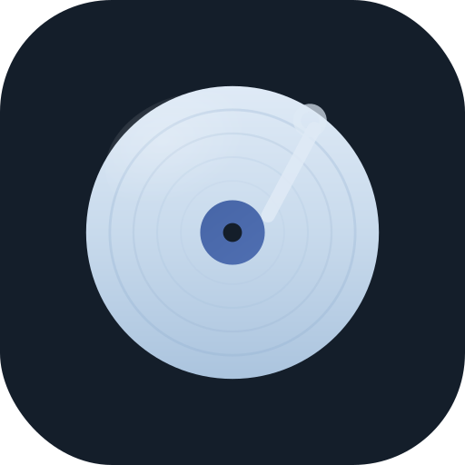
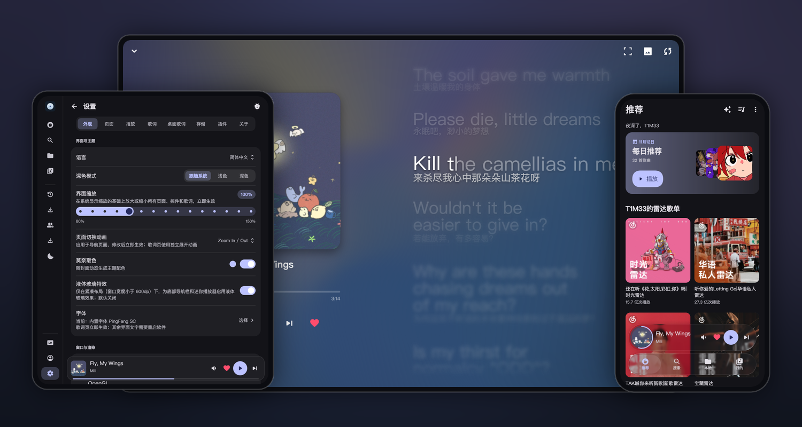
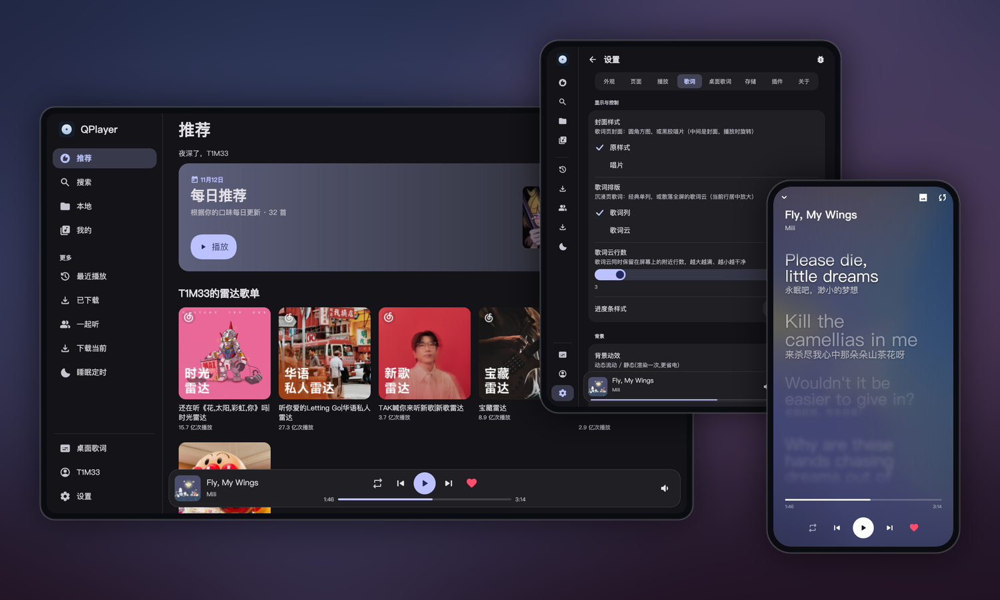

<p align="center">
  
</p>

<h1 align="center">QPlayer</h1>

<p align="center">
  <a href="README.md">简体中文</a> · <b>English</b>
</p>

<p align="center">
  <b>An extensible cross-platform music player with a QML-rendered UI</b><br>
  Powered by <a href="https://github.com/TIMER-err/qml4j">qml4j</a>
</p>

<p align="center">
  
  
  
  
  <a href="https://appimage.github.io/QPlayer/"></a>
  <a href="LICENSE.md"></a>
</p>

---

<p align="center">
  
</p>
<p align="center">
  <sub>Phone recommendations · Tablet settings · Desktop lyrics</sub>
</p>
<p align="center">
  
</p>
<p align="center">
  <sub>Desktop recommendations · Tablet settings · Phone lyrics</sub>
</p>

The UI uses no native Views. Every control is described in QML and rendered by
qml4j, except the lyric-page body (per-syllable scrolling, fluid backdrop), which the
host draws directly through Skija. qml4j is itself a QML runtime written in pure
Java.

Android and desktop load the same QML and the same `player-core` logic: one UI
running in two host shells.

<a href="https://www.star-history.com/?repos=TIMER-err%2Fqplayer&type=date&legend=top-left">
 <picture>
   <source media="(prefers-color-scheme: dark)" srcset="https://api.star-history.com/chart?repos=TIMER-err/qplayer&type=date&theme=dark&legend=top-left&sealed_token=pvVKTlOWl7Lak9qFpFBXwrZXczfPyNb2ZD6ZbfiJY2us9fPe7ck5CffvPIOKcTPhT9B6J92c16ce9UrxUIJ-hwpT4WlDEdPJJ5MFvDSvK9CTG1wry56KYPc0OyDhCujlPX35c-dFPj9xU7IqhAEkH6Xz3Q13--zsYmcC_WLSYtiPKr_Et0O9x5sj-mZr" />
   <source media="(prefers-color-scheme: light)" srcset="https://api.star-history.com/chart?repos=TIMER-err/qplayer&type=date&legend=top-left&sealed_token=pvVKTlOWl7Lak9qFpFBXwrZXczfPyNb2ZD6ZbfiJY2us9fPe7ck5CffvPIOKcTPhT9B6J92c16ce9UrxUIJ-hwpT4WlDEdPJJ5MFvDSvK9CTG1wry56KYPc0OyDhCujlPX35c-dFPj9xU7IqhAEkH6Xz3Q13--zsYmcC_WLSYtiPKr_Et0O9x5sj-mZr" />
   
 </picture>
</a>

## Sponsors

<p align="center">
  Thank you to everyone supporting the continued development of QPlayer.<br><br>
  <a href="https://ifdian.net/a/TIMER_err"></a><br><br>
  <a href="https://ifdian.net/a/TIMER_err"></a>
</p>

## Features

- Local library, playback queue, repeat, shuffle and sleep timer.
- Syllable-synced lyrics, translations, romanization and fluid backgrounds; [Lyricon](https://github.com/tomakino/lyricon) support on Android.
- Responsive Miuix interface for phones, tablets and desktops, with light/dark themes, dynamic color and optional liquid glass.
- Desktop tray and system media controls; Android lockscreen, notification and Bluetooth controls.
- Plugins for online sources, search, playlists and accounts.

QPlayer includes no online music source. Without a source plugin, it is a local player. Plugin permissions require user approval at installation.

## Download

Get the Android APK or a desktop package from [Releases](https://github.com/TIMER-err/qplayer/releases). Desktop packages require no Java installation.

See the [desktop guide](desktop-host/dist/README.md) for Linux runtime dependencies and platform packaging requirements.

## Development

| Module | Purpose |
|---|---|
| `player-core/` | Shared playback logic, plugins and lyrics |
| `shared-qml/` | Shared interface, components and fonts |
| `qml-aot-tool/` | Build-time QML compilation and native metadata |
| `android-shell/` | Android host |
| `desktop-host/` | Desktop host and native packaging |

The [qml4j](https://github.com/TIMER-err/qml4j) engine comes from JitPack as `com.github.TIMER-err.qml4j:qml4j-core`, with its version set by `qml4j.version` in the root POM. It is not part of this repository.

### Build and run

Requires JDK 21 and Maven, plus the Android SDK for Android builds.

**Android**

```sh
mvn -q -pl player-core -am install
cd android-shell
./gradlew :app:assembleDebug
```

The APK is under `android-shell/app/build/outputs/apk/debug/`.

**Desktop**

```sh
mvn -q -pl desktop-host -am install
mvn -pl desktop-host exec:exec
```

JVM runs on macOS require `-XstartOnFirstThread`. Native packages use GraalVM; see the [desktop release guide](desktop-host/dist/README.md).

### Documentation

- [Plugin development](docs/plugins.md) · [Plugin template](https://github.com/TIMER-err/qplayer-plugin-template)
- [Plugin permissions and security](docs/plugin-security.md)
- [Miuix interface](docs/miuix-ui.md)

Login credentials are encrypted, preferably using the system credential store, with an explicit local-key fallback when unavailable. This protects files at rest, not against same-user malware, root/administrator access or live-memory reads. See the security model for details.

### Releasing

Keep `versionName` in `android-shell/app/build.gradle.kts` and `qplayer.app.version` in `desktop-host/pom.xml` in sync, and increment Android `versionCode`. Pushing a `v<versionName>` tag builds and publishes Android and all three desktop platforms.

## Credits

- [qml4j](https://github.com/TIMER-err/qml4j) — the pure-Java QML engine that runs the UI.
- [Skija](https://github.com/HumbleUI/Skija) — Skia bindings for the JVM; the renderer and the host-drawn lyric page both draw through it.
- [miuix-qml](https://github.com/TIMER-err/miuix-qml) — the Miuix QML component library, based on [compose-miuix-ui/miuix](https://github.com/compose-miuix-ui/miuix).
- [SPlayer](https://github.com/imsyy/SPlayer) — visual and implementation reference for the fluid lyrics backdrop.
- [AMLL](https://github.com/amll-dev/amll-player) — design reference for Apple Music-style lyrics and fluid backdrops.
- [swingwebview](https://github.com/webliteca/swingwebview) — its native system WebView backends, hosted through standalone JNI without the Swing layer.
- Icons are Material Symbols Rounded.

> QPlayer provides no online source and no copyrighted media. Plugin authors and
> users are responsible for service terms and local law.

## License

[Apache License 2.0](LICENSE.md).
