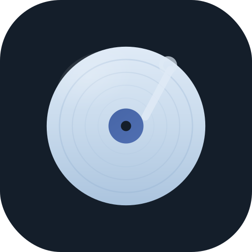
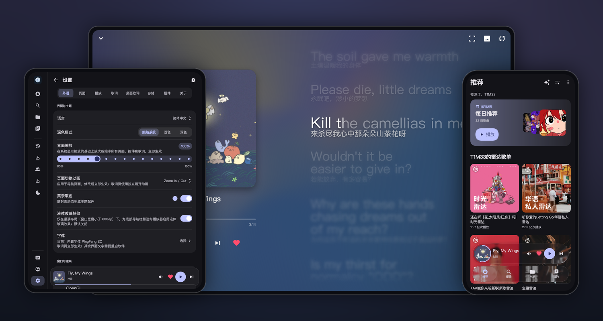
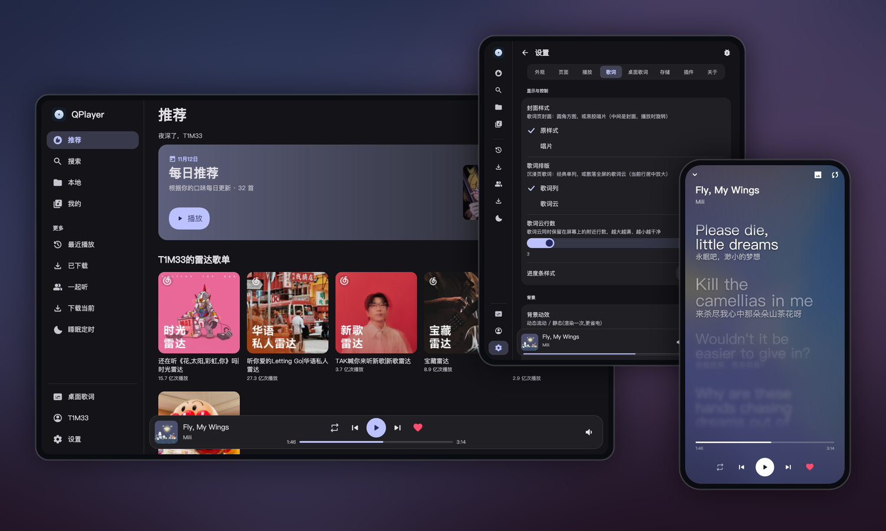

<p align="center">
  
</p>

<h1 align="center">QPlayer</h1>

<p align="center">
  <b>简体中文</b> · <a href="README.en.md">English</a>
</p>

<p align="center">
  <b>一个界面由 QML 渲染的跨平台、可扩展音乐播放器</b><br>
  由 <a href="https://github.com/TIMER-err/qml4j">qml4j</a> 强力驱动
</p>

<p align="center">
  
  
  
  
  <a href="https://appimage.github.io/QPlayer/"></a>
  <a href="LICENSE.md"></a>
</p>

---

<p align="center">
  
</p>
<p align="center">
  <sub>手机推荐 · 平板设置 · 桌面歌词</sub>
</p>
<p align="center">
  
</p>
<p align="center">
  <sub>桌面推荐 · 平板设置 · 手机歌词</sub>
</p>

界面不使用任何原生 View。除歌词页正文外，所有控件都由 QML 描述、经 qml4j 渲染；
歌词正文（逐字滚动 + 流体背景）由宿主通过 Skija 直接绘制，不走 QML。qml4j 本身是一个
用纯 Java 实现的 QML 运行时。

安卓与桌面加载同一份 QML 和同一套 `player-core` 逻辑，即同一个界面运行在两个宿主壳中。

<a href="https://www.star-history.com/?repos=TIMER-err%2Fqplayer&type=date&legend=top-left">
 <picture>
   <source media="(prefers-color-scheme: dark)" srcset="https://api.star-history.com/chart?repos=TIMER-err/qplayer&type=date&theme=dark&legend=top-left&sealed_token=pvVKTlOWl7Lak9qFpFBXwrZXczfPyNb2ZD6ZbfiJY2us9fPe7ck5CffvPIOKcTPhT9B6J92c16ce9UrxUIJ-hwpT4WlDEdPJJ5MFvDSvK9CTG1wry56KYPc0OyDhCujlPX35c-dFPj9xU7IqhAEkH6Xz3Q13--zsYmcC_WLSYtiPKr_Et0O9x5sj-mZr" />
   <source media="(prefers-color-scheme: light)" srcset="https://api.star-history.com/chart?repos=TIMER-err/qplayer&type=date&legend=top-left&sealed_token=pvVKTlOWl7Lak9qFpFBXwrZXczfPyNb2ZD6ZbfiJY2us9fPe7ck5CffvPIOKcTPhT9B6J92c16ce9UrxUIJ-hwpT4WlDEdPJJ5MFvDSvK9CTG1wry56KYPc0OyDhCujlPX35c-dFPj9xU7IqhAEkH6Xz3Q13--zsYmcC_WLSYtiPKr_Et0O9x5sj-mZr" />
   
 </picture>
</a>

## 赞助者

<p align="center">
  感谢每一位支持 QPlayer 持续开发的赞助者。<br><br>
  <a href="https://ifdian.net/a/TIMER_err"></a><br><br>
  <a href="https://ifdian.net/a/TIMER_err"></a>
</p>

## 功能

- 本地音乐库、播放队列、循环与随机播放、睡眠定时。
- 逐字歌词、翻译与罗马音、流体背景；Android 支持[词幕](https://github.com/tomakino/lyricon)。
- 自适应手机、平板与桌面的 Miuix 界面，支持深浅主题、动态配色和可选的液态玻璃。
- 桌面托盘、系统媒体控制；Android 锁屏、通知栏与蓝牙控制。
- 通过插件扩展在线音源、搜索、歌单与账号功能。

QPlayer 不内置在线音源。未安装音源插件时，它是本地播放器；插件权限在安装时由用户确认。

## 下载

从 [Releases](https://github.com/TIMER-err/qplayer/releases) 下载 Android APK 或对应平台的桌面包。桌面版无需安装 Java。

Linux 运行依赖及各平台打包要求见[桌面说明](desktop-host/dist/README.md)。

## 开发

| 模块 | 用途 |
|---|---|
| `player-core/` | 共享播放逻辑、插件系统与歌词 |
| `shared-qml/` | 共享界面、组件与字体 |
| `qml-aot-tool/` | 构建期 QML 编译与原生元数据生成 |
| `android-shell/` | Android 宿主 |
| `desktop-host/` | 桌面宿主与原生打包 |

界面引擎 [qml4j](https://github.com/TIMER-err/qml4j) 通过 JitPack 依赖 `com.github.TIMER-err.qml4j:qml4j-core` 使用，版本统一读取根 POM 的 `qml4j.version`，不包含在本仓库中。

### 构建与运行

需要 JDK 21、Maven；Android 构建还需 Android SDK。

**Android**

```sh
mvn -q -pl player-core -am install
cd android-shell
./gradlew :app:assembleDebug
```

APK 位于 `android-shell/app/build/outputs/apk/debug/`。

**桌面**

```sh
mvn -q -pl desktop-host -am install
mvn -pl desktop-host exec:exec
```

macOS 的 JVM 运行需要 `-XstartOnFirstThread`。原生包使用 GraalVM，构建步骤见[桌面打包说明](desktop-host/dist/README.md)。

### 文档

- [插件开发](docs/plugins.md) · [插件模板](https://github.com/TIMER-err/qplayer-plugin-template)
- [插件权限与安全模型](docs/plugin-security.md)
- [Miuix 界面](docs/miuix-ui.md)

登录凭据加密存储，优先使用系统密码库；不可用时可明确选择本地密钥回退。这只提供静态文件保护，不防同用户恶意程序、root/管理员权限或运行时内存读取，详见安全模型。

### 发版

保持 `android-shell/app/build.gradle.kts` 的 `versionName` 与 `desktop-host/pom.xml` 的 `qplayer.app.version` 一致，并递增 Android `versionCode`。推送 `v<versionName>` tag 后，CI 构建并发布 Android 与三平台桌面包。


## 致谢

- [qml4j](https://github.com/TIMER-err/qml4j) —— 运行整个界面的纯 Java QML 引擎。
- [Skija](https://github.com/HumbleUI/Skija) —— JVM 上的 Skia 绑定；渲染器与宿主绘制的歌词页都通过它输出。
- [miuix-qml](https://github.com/TIMER-err/miuix-qml) —— Miuix QML 组件库（`miuix.Core`），视觉参考 [compose-miuix-ui/miuix](https://github.com/compose-miuix-ui/miuix)。版本与许可见 `shared-qml/miuix/`。
- [SPlayer](https://github.com/imsyy/SPlayer) —— 流体歌词背景的视觉与实现参考。
- [AMLL](https://github.com/amll-dev/amll-player) —— Apple Music 风格歌词与流体背景的设计参考。
- [swingwebview](https://github.com/webliteca/swingwebview) —— 保留其系统 WebView 原生后端，以独立 JNI 层完成桌面网页登录，不加载 Swing 层。
- 图标使用 Material Symbols Rounded。

> QPlayer 不提供在线音源，也不分发受版权保护的媒体。插件作者与用户需自行遵守服务条款
> 及当地法律。

## 许可证

[Apache License 2.0](LICENSE.md)。
